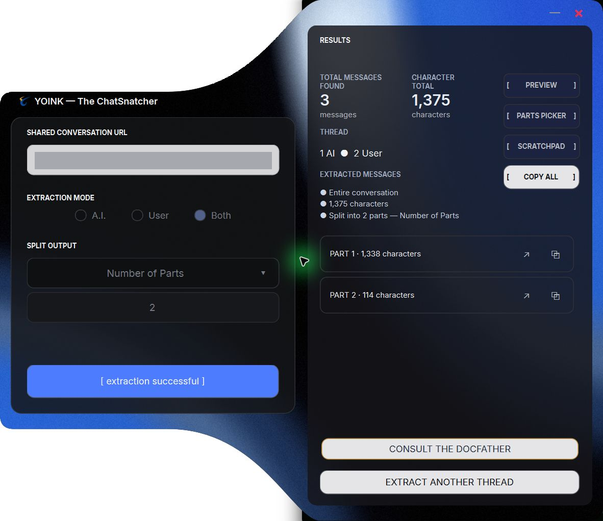
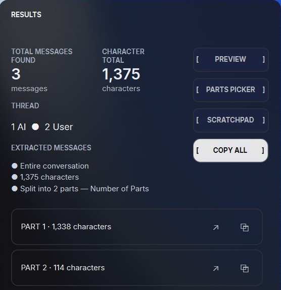
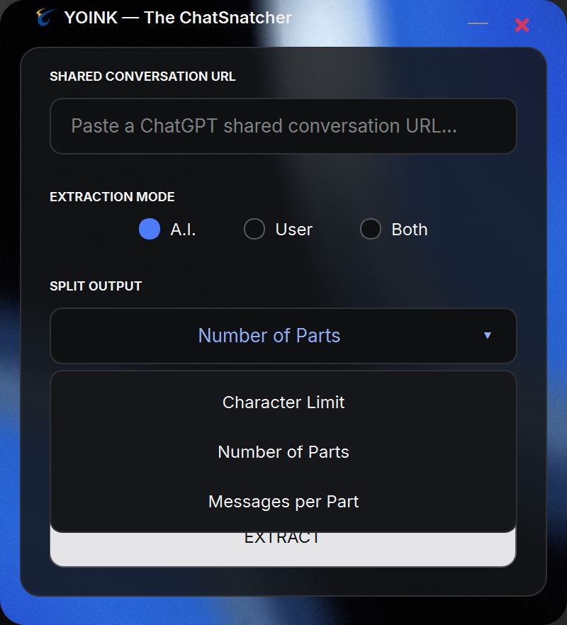
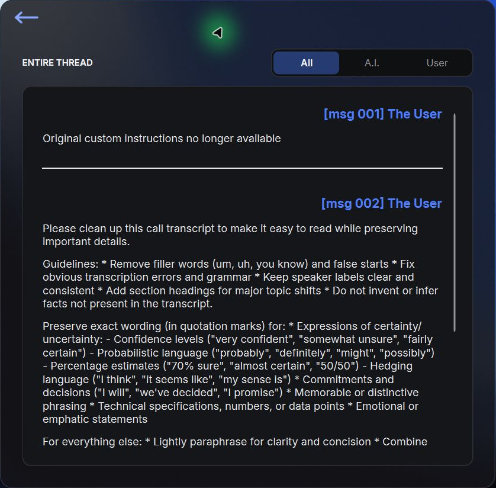
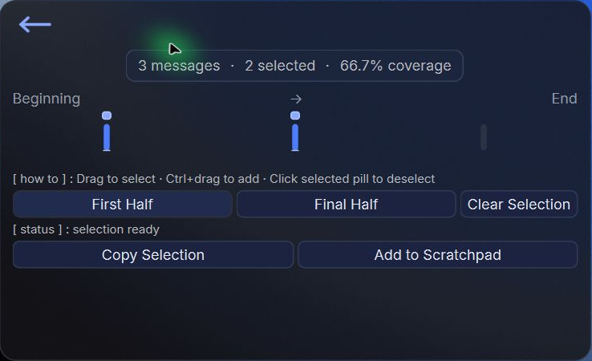
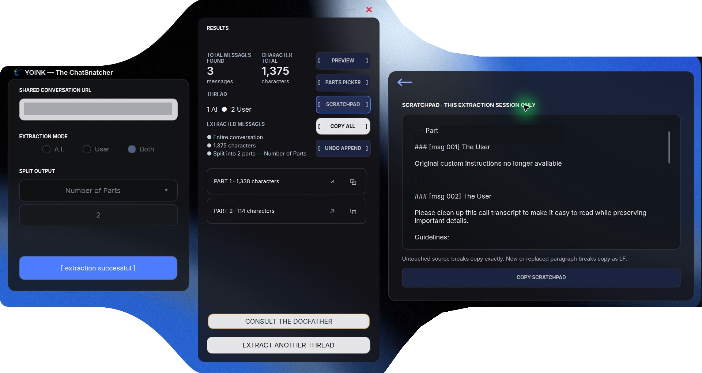
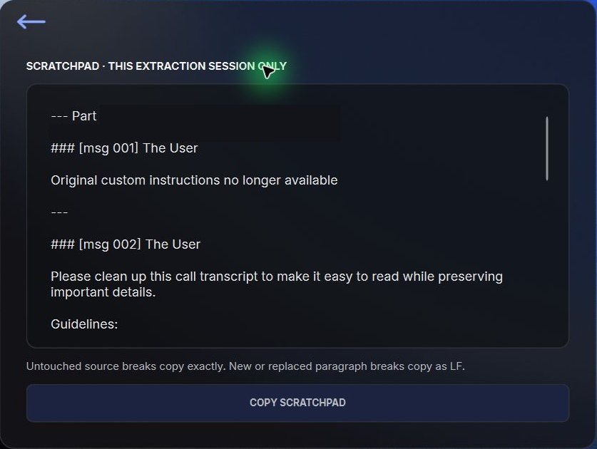
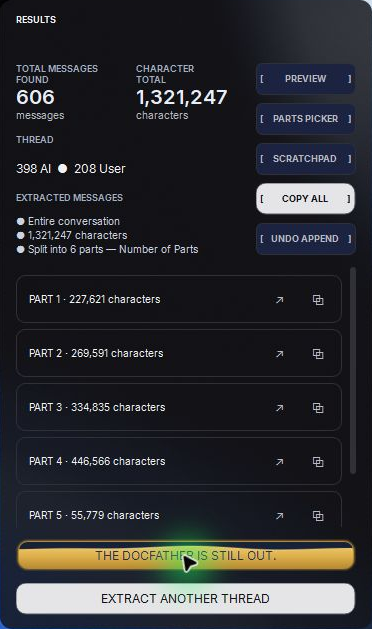

<p align="center">
  
</p>

# Want a free unlimited context window for ChatGPT?

**TOO BAD. YOU'RE POOR.**

So am I. That's why I made YOINK.

**YOINK does not actually give ChatGPT an unlimited context window.** If I could do that, this README would be significantly shorter. It makes your context **portable**: extract a shared conversation, split it into useful pieces, and carry what matters into the next chat. Update your project record, bring the relevant files, and keep going without excavating a 400-message thread.

**The chat is disposable. The project context isn't.**

**[Download YOINK v1.1.1 — New Face, Same Habit for Windows x64](https://github.com/kennclark-yb/YOINK/releases/tag/v1.1.1)**

## Meet The ChatSnatcher

<p align="center">
  
</p>

<p align="center"></p>

**Y.O.I.N.K.** stands for **Your Oversized Interactions, Nicely Kept.** Give the ChatSnatcher a public ChatGPT shared conversation link and it turns the messages into Markdown-formatted text you can inspect, split, and copy.

## What YOINK Does

- **Extract:** Choose A.I., User, or Both. Output keeps message order, headings, role labels, and separators.
- **Split:** Choose Character Limit, Number of Parts, or Messages per Part. Messages stay intact.
- **Select ranges:** Use Parts Picker to select message ranges, preview or copy the selection, or add it to Scratchpad.
- **Preview:** Read the entire conversation and filter the view by All, A.I., or User. The filter doesn't change your output mode.
- **Collect:** Use the connected Scratchpad for notes and appended selections. Undo the latest append while it remains available, then copy the contents.

Scratchpad is for the current extraction session only. It isn't saved to disk; copy anything you need before extracting another thread or closing YOINK. Manual edits can make append Undo unavailable.

## Download & Install

Get the Windows x64 ZIP from the **[v1.1.1 — New Face, Same Habit release](https://github.com/kennclark-yb/YOINK/releases/tag/v1.1.1)**.

1. Extract the entire ZIP folder somewhere permanent.
2. Keep `YOINK.exe` and the `_internal` folder together. Run `YOINK.exe` from that folder.
3. For desktop access, create a shortcut to the executable rather than moving it.

No installer, Python installation, or separate Chromium installation is required. The build is unsigned, so Windows may show a security or reputation warning. Source and build instructions are available if you'd rather inspect or build it yourself.

## See It in Action

Start with a public share, then inspect and collect the context worth carrying forward.

1. Create a **standard public shared conversation link** in ChatGPT and paste it into YOINK.
2. Choose the message roles and a split mode. Number of Parts and Messages per Part require a positive whole number; an empty Character Limit defaults to 9000. Click **Extract**.

<p align="center"></p>

3. Inspect the results. Open **Preview** to read the whole thread, copy individual parts, or use **Copy All**.

<p align="center"></p>

4. Open **Parts Picker** to select ranges. Preview or copy the selection, or append it to **Scratchpad** alongside your own notes. Use **Undo Append** when available.

<p align="center"></p>

<p align="center"></p>

*Preview, Parts Picker and Scratchpad share the connected workspace beside Results.*

<details>
<summary>Scratchpad and DOCFATHER up close</summary>

<p align="center"></p>

<p align="center"></p>

</details>

YOINK checks for updates quietly at startup; press **Ctrl+U** for a manual check. Updates are downloaded and unpacked by you, not installed automatically.

## Limitations & What's Next

YOINK v1 supports standard public ChatGPT shared conversation URLs (`https://chatgpt.com/share/...`). It does **not** support Project-shared links, Codex snapshots, private conversation URLs, Claude, or Gemini. Extraction requires internet access and depends on the availability and structure of ChatGPT's shared pages; changes there may require an update.

The portable build is large because it includes its browser runtime. The fat bastard brought luggage.

**THE DOCFATHER** in v1.1.0 is a teaser, not a working assistant. The functional document workflow and optional AI integrations are separate plans for v2. Non-ChatGPT extraction platforms are deferred beyond v2.0.0. See [ROADMAP_V2.md](ROADMAP_V2.md). No release date or blood oath.

## Under the Hood

YOINK targets Windows. Dependencies are pinned in `requirements.txt` and `requirements-build.txt`. To build the Windows package:

```powershell
.\build_windows.ps1
```

See [BUILDING.md](BUILDING.md) for requirements and packaging details. Automated tests live in [tests/](tests/); run the relevant tests when changing extraction, formatting, the GUI, or packaging. Contributions are welcome: read [CONTRIBUTING.md](CONTRIBUTING.md), keep changes focused, and don't break the ChatSnatcher.

YOINK is released under the [MIT License](LICENSE). Copyright © 2026 autowolf.
